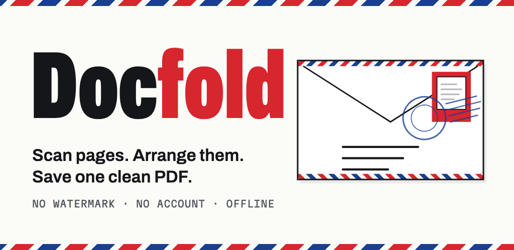
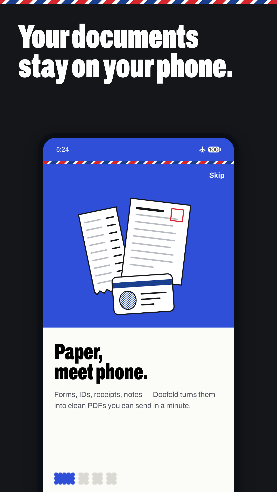
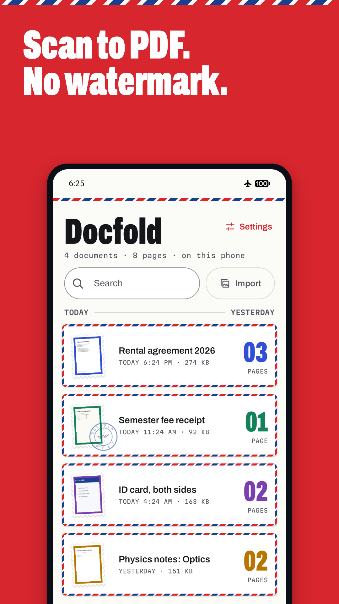
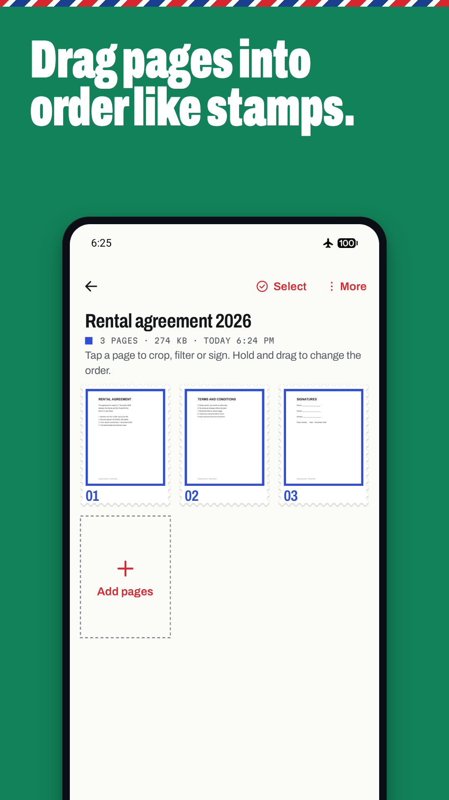
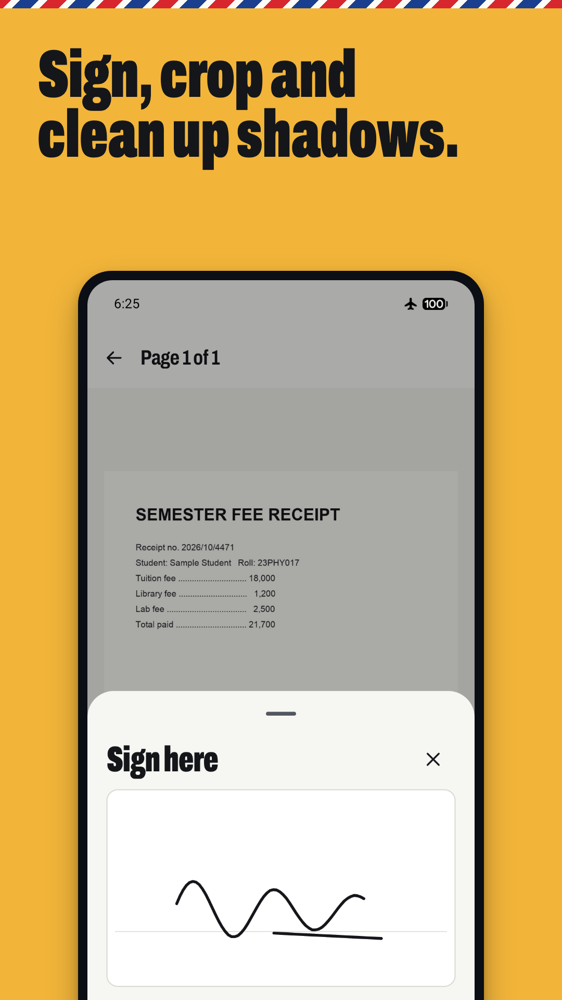
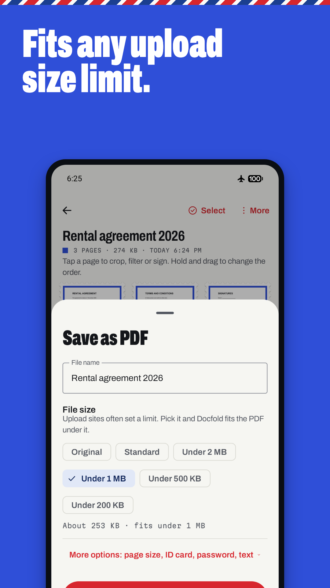

# Docfold — Doc Scanner to PDF



A free, offline Android document scanner: scan pages, arrange them like stamps, save one clean PDF. Native Kotlin + Jetpack Compose, ~4 MB installed, no database, no account, AdMob-supported. Plus a small Next.js site (privacy policy + `app-ads.txt`) for Vercel.

## Screenshots

<p align="center">
  
  
  
  
  
</p>

## What's inside

```
android/          The app (Kotlin, Compose, Material 3) — open this folder in Android Studio
website/          Next.js 16 site: home, /privacy, /app-ads.txt (deploy root on Vercel)
store-assets/     Play Store icon, feature graphic, 5 phone screenshots
PUBLISHING.md     Step-by-step: AdMob, keys, Vercel, Play Console, Data safety, testing
STORE_LISTING.md  Title, descriptions, category, keywords — copy-paste ready
PRODUCT.md        Product truth (users, positioning, constraints)
DESIGN.md         The "Airmail Post" design system, derived from the shipped app
```

## Features (paid elsewhere, free here)

Competitor review research (CamScanner, Adobe Scan, Genius Scan, SwiftScan, and Microsoft Lens, which was retired from Play in Feb 2026) showed users pay for, or complain about, the gaps below. Docfold closes each one:

| Users complained about | Docfold |
|---|---|
| Watermark on free PDFs | Never a watermark |
| OCR / searchable PDF paywalled | On-device OCR, searchable PDFs, copy text |
| Scan limits, ads between every scan | Unlimited; no ads during scanning or editing |
| Account + cloud upload required | No account; nothing leaves the phone |
| Can't reorder pages after capture | Drag-to-reorder stamp sheet |
| Merge / sign / password paywalled | Merge docs, import PDFs, finger signature, AES-256 password |
| Huge PDFs, portal upload limits | "Under 1 MB / 500 KB / 200 KB" auto-fit |
| ID card front+back | ID-card layout at real card size |
| 200–300 MB apps that drain batteries | ~4 MB; Google's scanner is delivered by Play services |

New from user research: one-file backup and restore, folders, custom upload sizes down to a few KB with exact fitting, a photo and signature tool with exact pixels and Min/Max KB for online forms, naming a document from its first page, print, and remembered save settings.

Also: crop with perspective fix, Magic / Grayscale / B&W filters with shadow removal, rotate (lossless), duplicate, move pages to a new doc, import photos/PDFs, share-to-Docfold from any app, save to Downloads or share, JPG export, dark theme, launcher "Scan" shortcut.

## Built for low-end phones

- Custom PDF writer embeds JPEGs directly (no re-compression, one page in memory at a time), with optional AES-256 (PDF 2.0, R6).
- Image sizes adapt to the phone's RAM; thumbnails are decoded two at a time into a heap-sized cache.
- Asks for the camera before the first scan and for saving before the first save. Photos come through the system photo picker, so no photo access is requested. No contacts or location.
- R8-minified release: 3.9 MB universal APK, about 0.8 s cold start on the emulator.
- Fallback for phones without Google's scanner: system camera + 4-corner perspective crop.

## Run it

Android (debug, uses Google's test ad IDs):

```bash
cd android && JAVA_HOME="/Applications/Android Studio.app/Contents/jbr/Contents/Home" ./gradlew installDebug
```

Unit tests (PDF writer, encryption):

```bash
cd android && JAVA_HOME="/Applications/Android Studio.app/Contents/jbr/Contents/Home" ./gradlew testDebugUnitTest
```

Website:

```bash
cd website && npm run dev
```

## Placeholders to fill before publishing

- `android/keys.properties`: upload key passwords (AdMob IDs are already in it)

Already set: AdMob app + Banner + Interstitial IDs; developer Sandipan Sarkar; support email sarkarsandipan423@gmail.com; site https://docfold.vercel.app with a live `app-ads.txt`.

Then follow `PUBLISHING.md`.
